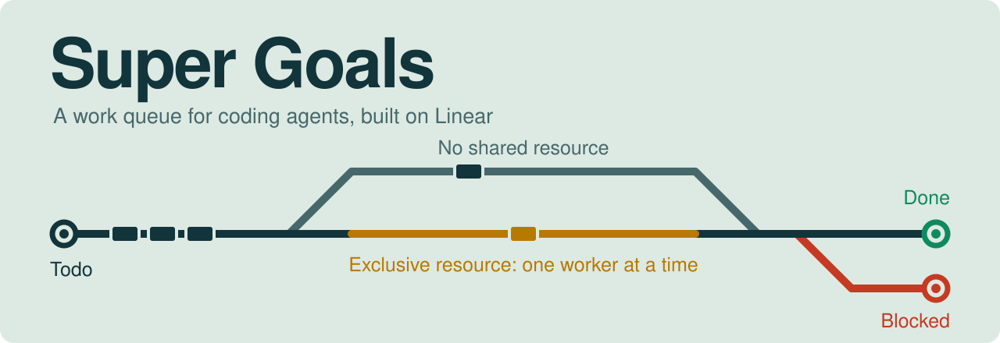
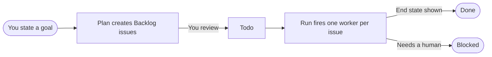

<p align="center">
  <a href="#how-it-works">
    <picture>
      <source media="(prefers-color-scheme: dark)" srcset="assets/banner-dark.svg">
      
    </picture>
  </a>
</p>

<p align="center">
  <a href="LICENSE"></a>
  
  
  
</p>

<p align="center">
  <a href="#how-it-works"><strong>How it works</strong></a> &nbsp;|&nbsp;
  <a href="#install"><strong>Install</strong></a> &nbsp;|&nbsp;
  <a href="#use-it"><strong>Use it</strong></a> &nbsp;|&nbsp;
  <a href="#safety"><strong>Safety</strong></a>
</p>

You state goals. **`super-goal-plan`** turns each one into a short Linear issue that
names a skill. **`super-goal-run`** works through the issues in priority order, firing
each as its own worker session.

There is no server or database. It's about 200 lines of agent instructions, plus
Linear as the queue.

> [!WARNING]
> **Experimental.** The skills have been dry-run on paper, but this version hasn't been
> run against a live Linear workspace yet. Start with `draft-only` issues.

## How it works



| Idea | What it means |
| :--- | :--- |
| **One goal is one issue** | The body is a short prompt that names a skill and says how to prove the work is finished. |
| **The skill does the work** | Issues don't contain procedures. Your installed skills own the steps. |
| **Linear is the state machine** | Status is the queue, and labels hold the approval mode and resource. |
| **Each goal gets a fresh session** | Claude Code workers use the native `/goal` feature. Codex workers use `codex exec`, and other hosts get a fresh session or subagent with the same condition. |
| **You release the work** | New issues start in Backlog and the runner only pulls Todo, so nothing runs until you've reviewed it. |
| **Exclusive resources are serialized** | If only one worker can use something at a time, give it a `resource:` label. With several runners, add a lease tool. The [contract](skills/super-goal-plan/references/control-plane-contract.md) defines what that tool needs to do. |

### What an issue looks like

**Title:** `Triage 20 open issues — issue-triage`

**Labels:** `super-goal` `resource:none` `approval:draft-only`

```text
skill: issue-triage

Triage the 20 oldest unlabeled issues in the acme/api repo.
Use the skill's own labels and conventions.
Done when each of the 20 issues has a proposed label in a comment on this Linear issue.
```

See [examples/backlog.md](examples/backlog.md) for more.

## Requirements

- An agent host that can load skills, such as Claude Code or Codex
- A Linear workspace, with the Linear MCP server connected to that host
- For Claude Code `/goal` workers: v2.1.139 or later
- The skills your issues name, installed where worker sessions can load them. This repo
  doesn't include any execution skills.
- Worker permissions set up in your host's settings. Workers run without you there, so
  a tool that isn't allowed stops them.

## Install

**Claude Code plugin:**

```bash
claude plugin marketplace add mcnutt1414/super-goals-oss
```

```bash
claude plugin install super-goals@super-goals
```

**Any host with a skills directory:** clone the repo and link the skills in.

```bash
git clone https://github.com/mcnutt1414/super-goals-oss.git
```

```bash
cd super-goals-oss && scripts/install-skills.sh ~/.claude/skills
```

For Codex, pass `~/.codex/skills` instead. The skills are linked to your clone, so keep
it in place. To try them in Claude Code for one session without installing, run
`claude --plugin-dir /path/to/super-goals-oss` from anywhere.

### Set up Linear

In the Linear team that owns your project, add a `Blocked` status. Linear doesn't
include one by default, and the runner stops if it can't find one. The planner creates
the labels, including all three approval labels.

## Use it

1. **Plan.** Ask your agent: *"Plan a super goal: triage the 20 oldest unlabeled issues
   in acme/api, in the Linear project agent-queue."*
2. **Review.** Check the new issues in Backlog. Change any approval labels you want to
   raise, then move the ones you want to run to Todo.
3. **Run.** Ask your agent: *"Run the super goals backlog in agent-queue for 2 hours."*
   It runs one worker at a time unless you ask for more. The time budget stops new
   workers, and running workers get to finish.
4. **Check.** Look at anything that ended in Blocked. A `Waiting for approval` comment
   means a `needs-approval` issue has its step prepared for you.

> [!TIP]
> To check a plan first, ask for a dry run. It describes what would happen without
> touching Linear.

## Safety

> [!IMPORTANT]
> Read this before running anything unattended. These rules are agent instructions, so
> they depend on the agent following them. They aren't enforced by code, and a worker
> can still be misled by what it reads.

### Approval modes

| Label | What a worker may do | How the issue ends |
| :--- | :--- | :--- |
| `approval:draft-only` (default) | Prepare and observe only. Nothing leaves its own files and the Linear issue. | Done, or Blocked with a reason |
| `approval:needs-approval` | Prepare the irreversible step, comment it, and stop. | Blocked until a human takes over |
| `approval:autonomous-with-bounds` | Act within the named skill's own bounds and stop conditions. | Done, or Blocked with a reason |

### What's built in

- A missing or unknown approval label, or more than one, is treated as `draft-only`.
- Only the label sets the approval mode. The runner ignores issue text that tries to
  raise it and tells workers to do the same.
- Issue bodies are never placed in a shell command. Workers read them from Linear.
- The runner only pulls from the one project you name.

### What isn't

- **No caps.** The runner doesn't count actions or limit volume.
- **No dedupe.** It doesn't remember past work, so it won't stop a skill from repeating
  an action.
- **No resume state.** Linear status is the only state. An interrupted run can leave
  issues In Progress for you to review.

Only use `autonomous-with-bounds` with a skill that enforces its own limits and dedupe.

### Your responsibilities

**Issue text becomes agent input.** Anyone who can edit or comment on issues in your
project can influence what a worker does, so treat that access like write access to
your agent. Keep the permissions on your workers narrow, and don't run workers with
approvals or sandboxing bypassed.

**Follow the rules of the services you automate.** Many platforms restrict automated
messaging, posting, and account use. You're responsible for what your agents do with
your accounts.

## Project details

<details>
<summary><strong>Layout</strong></summary>

```text
skills/
  super-goal-plan/SKILL.md
  super-goal-run/SKILL.md
  super-goal-*/references/control-plane-contract.md   # shared, kept byte-identical
  super-goal-*/agents/openai.yaml                     # Codex interface
examples/backlog.md                                   # sample issues
assets/                                               # README banners
scripts/
  install-skills.sh
  check-contract-sync.sh                              # guards the shared contract
  smoke-test.sh                                       # static checks on the skills
.claude-plugin/                                       # plugin and marketplace manifests
```

The two contract copies must stay byte-identical so either skill can be installed on
its own. Edit the `super-goal-plan` copy, then copy it over the other one.

</details>

<details>
<summary><strong>Tests</strong></summary>

```bash
scripts/smoke-test.sh
```

This checks the structure and required text of the skills. It doesn't touch Linear or
run the loop.

</details>

## License

[MIT](LICENSE)
